# XCADTA
### Explainable Cross-Attention Drug–Target Affinity Prediction

XCADTA is a deep-learning framework for predicting drug–target binding affinity using molecular graph representations and protein sequence embeddings. It combines graph-based molecular learning, pretrained ESM-2 protein representations, and bidirectional cross-attention to model interactions between drug molecules and target proteins.

The project integrates an explainability pipeline, a FastAPI backend, and an interactive React-based dashboard for affinity prediction, visualization, and prediction history.

> **Research and demonstration note:** XCADTA generates computational affinity estimates and model-internal explanations. Attention and attribution scores indicate patterns learned by the model; they should not be interpreted as experimentally confirmed binding sites, molecular contacts, or clinical evidence.

---

## Table of Contents

1. [Project Overview](#project-overview)
2. [Key Features](#key-features)
3. [Application Screenshots](#application-screenshots)
4. [Research Figures](#research-figures)
5. [Model Architecture](#model-architecture)
6. [Technology Stack](#technology-stack)
7. [Project Structure](#project-structure)
8. [Experimental Results](#experimental-results)
9. [Installation and Setup](#installation-and-setup)
10. [Running the Application](#running-the-application)
11. [Training and Evaluation](#training-and-evaluation)
12. [API Documentation](#api-documentation)
13. [Datasets and Pretrained Models](#datasets-and-pretrained-models)
14. [Explainability and Interpretation](#explainability-and-interpretation)
15. [Reproducibility Notes](#reproducibility-notes)
16. [Acknowledgements](#acknowledgements)

---

## 1. Project Overview

Drug–target binding affinity prediction is an important computational task in drug discovery. Understanding the relationship between molecular structures and protein sequences can help identify and prioritize potential drug–target interactions.

XCADTA addresses this task through a cross-modal learning architecture that combines molecular graph representations with protein sequence representations.

The framework consists of:

- A graph-based drug encoder.
- Pretrained ESM-2 protein embeddings.
- Bidirectional cross-attention for drug–protein interaction modelling.
- A fusion and regression module for affinity prediction.
- Explainability outputs for inspecting model behaviour.
- A full-stack application for interactive inference and visualization.

---

## 2. Key Features

- **Molecular Graph Processing:** Converts drug SMILES strings into molecular graphs using RDKit.
- **Graph-Based Drug Encoding:** Uses Graph Attention Network (GAT) and Graph Convolutional Network (GCN) layers.
- **Protein Representation Learning:** Uses precomputed ESM-2 embeddings with 1280-dimensional residue representations.
- **Bidirectional Cross-Attention:** Models interactions between drug and protein representations.
- **Affinity Prediction:** Predicts KIBA binding affinity scores using a fusion and regression head.
- **Explainability:** Provides attention-based and residue-level attribution outputs.
- **Interactive Dashboard:** Supports drug–target prediction and visualization through a React frontend.
- **Prediction History:** Stores local prediction records using SQLite.
- **REST API:** Exposes prediction, explanation, protein, drug, and history endpoints through FastAPI.

---

## 3. Application Screenshots

The following screenshots demonstrate the major interfaces and capabilities of the XCADTA application.

All application screenshots are stored in:

`docs/screenshots/`

### 3.1 Home Page

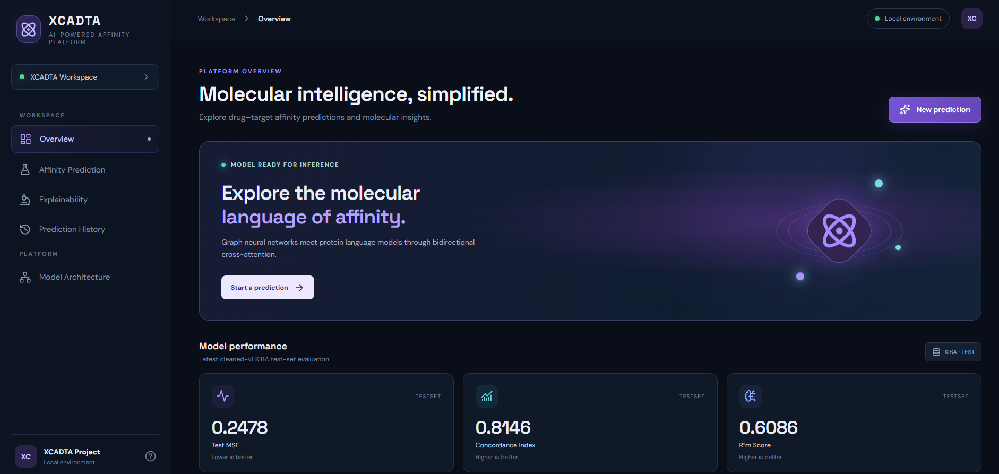

### 3.2 Affinity Prediction — Example 1

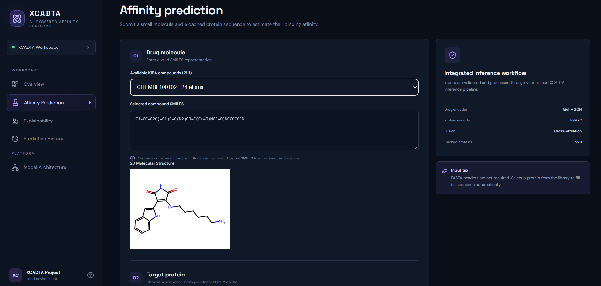

### 3.3 Affinity Prediction — Example 2

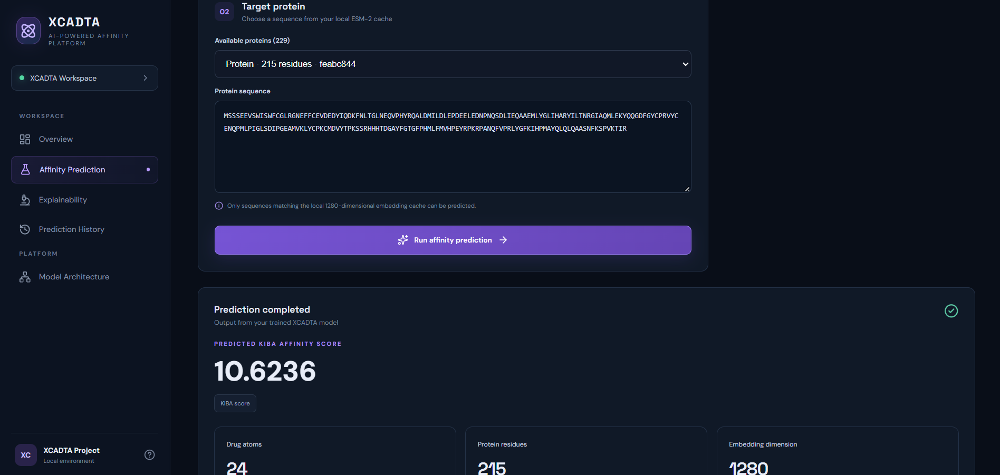

### 3.4 Affinity Prediction Heatmap

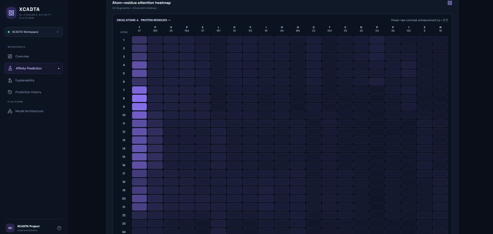

### 3.5 Explainability Dashboard

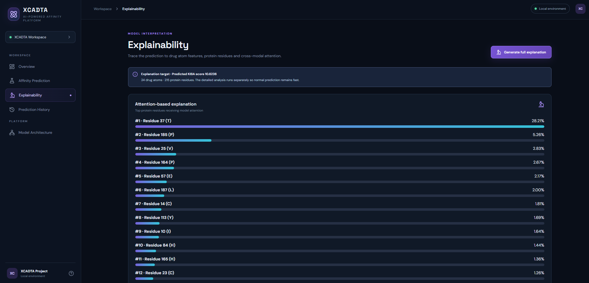

### 3.6 Detailed Explanation — View 1

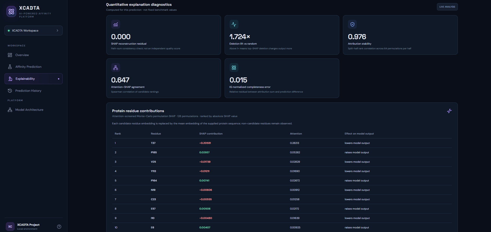

### 3.7 Detailed Explanation — View 2

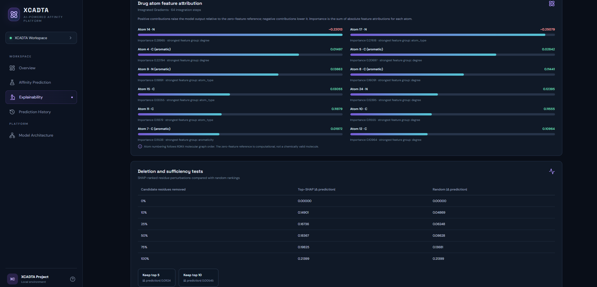

### 3.8 Detailed Explanation — View 3

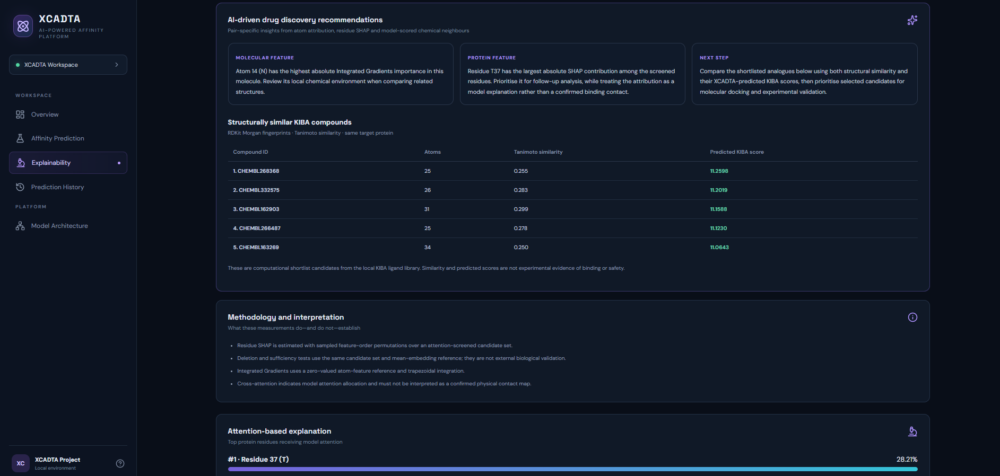

### 3.9 Detailed Explanation — View 4


### 3.10 Prediction History


### 3.11 Model Architecture


---

## 4. Research Figures

The following figures present the proposed architecture, model comparison, attention visualization, and explainability evaluation.

All five figures are available in `results/final_figures/`.

### Figure 1. XCADTA Model Architecture

The overall architecture of the proposed Explainable Cross-Attention Drug–Target Affinity Prediction framework.

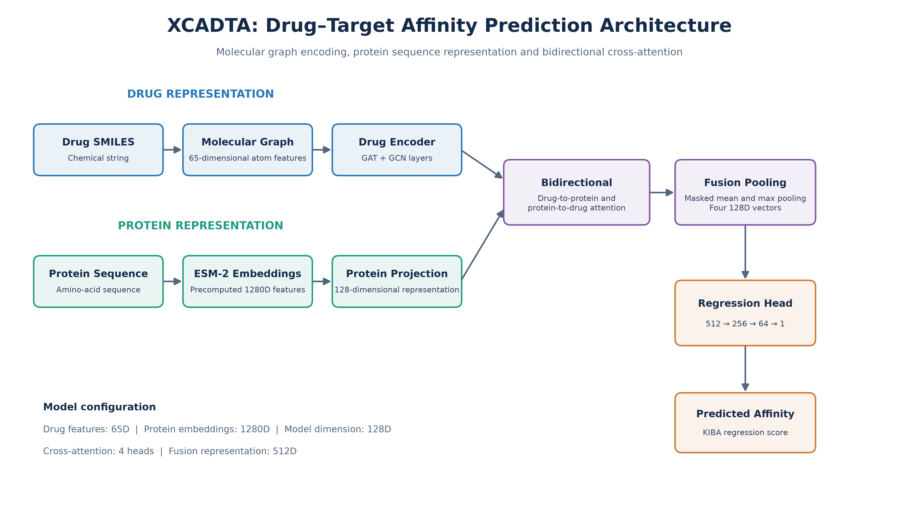

### Figure 2. XCADTA vs. Concatenation Ablation

Comparison of the proposed cross-attention fusion approach against the concatenation-based ablation model.

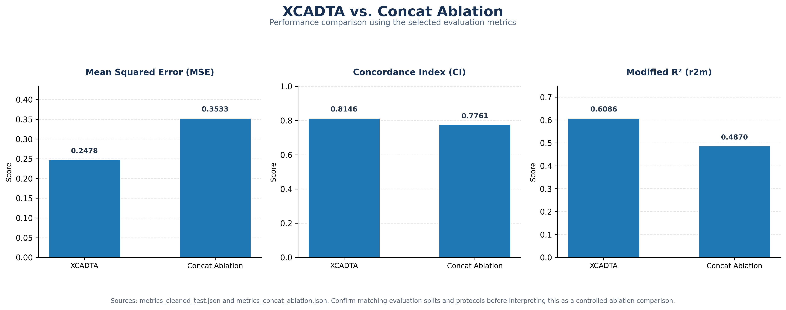

### Figure 3. Cross-Attention Heatmap

Visualization of cross-attention patterns between drug representations and protein representations.

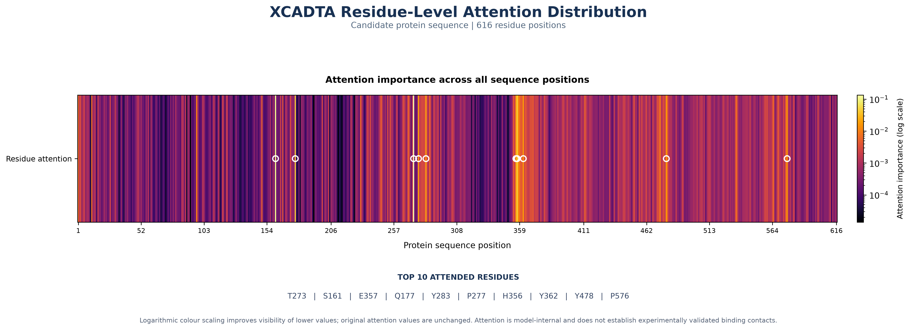

### Figure 4. Explainability Validation

Evaluation of the explainability framework using the reported validation metrics.

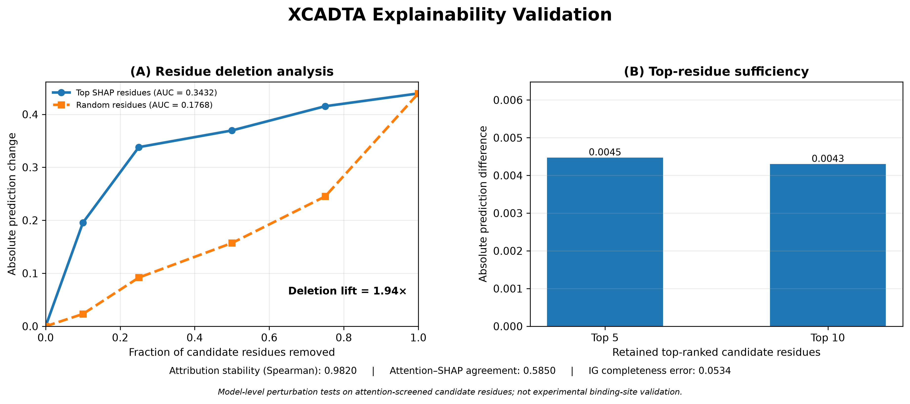

### Figure 5. Candidate Residue Attention

Residue-level attention visualization for the selected candidate protein.

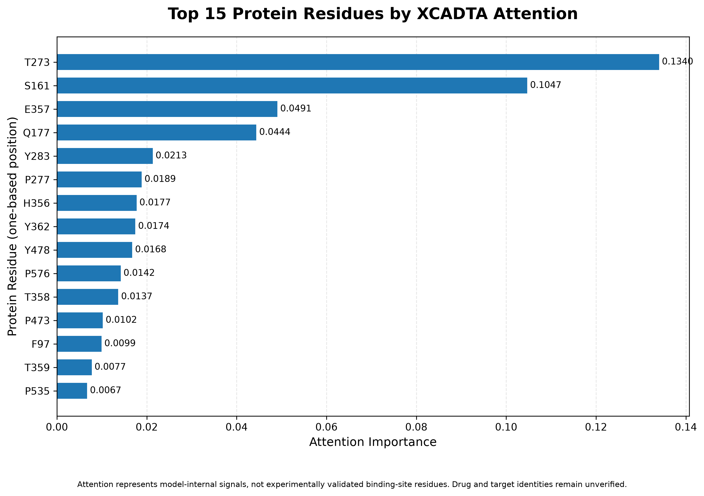

---

## 5. Model Architecture

XCADTA combines graph-based molecular learning and pretrained protein representations through a bidirectional cross-attention mechanism.

### 5.1 Drug Representation

- Input: Small-molecule SMILES string.
- Molecular graph generation using RDKit.
- Atom and bond feature extraction.
- Graph-based feature learning using GAT and GCN layers.

### 5.2 Protein Representation

- Input: Protein amino-acid sequence.
- Precomputed ESM-2 embeddings.
- Embedding dimensionality: 1280.
- Residue-level protein representations.

### 5.3 Bidirectional Cross-Attention

The drug and protein representations interact through bidirectional multi-head cross-attention.

- Drug-to-protein attention.
- Protein-to-drug attention.
- Four attention heads.
- Cross-modal feature integration.

### 5.4 Fusion and Regression

The resulting representations are combined through a fusion module and passed to a regression head to predict the drug–target affinity score.

---

## 6. Technology Stack

| Area | Technologies |
|---|---|
| Deep Learning | PyTorch, PyTorch Geometric |
| Molecular Processing | RDKit |
| Protein Embeddings | ESM-2, Transformers |
| Explainability | SHAP, attention-based analysis |
| Evaluation | scikit-learn, SciPy |
| Data Processing | NumPy, Pandas, NetworkX |
| Backend | FastAPI, Uvicorn |
| Frontend | React, Vite |
| Visualization | Recharts, Lucide React |
| Local Database | SQLite |
| Development | Python, JavaScript, Git, GitHub |

---

## 7. Project Structure

The main project layout is organised as follows:

```text
XCADTA/
│
├── data/
│   └── processed/
│       ├── cleaned_v1/
│       └── esm_embeddings.pt
│
├── checkpoints/
│   └── cleaned_v1/
│       └── xcadta_best.pt
│
├── docs/
│   └── screenshots/
│       ├── 01-home.png
│       ├── 02-affinity-1.png
│       ├── 03-affinity-2.png
│       ├── 04-affinity-heatmap.png
│       ├── 05-explainability.png
│       ├── 06-full-explanation-1.png
│       ├── 07-full-explanation-2.png
│       ├── 08-full-explanation-3.png
│       ├── 09-full-explanation-4.png
│       ├── 10-prediction-history.png
│       └── 11-model-architecture.png
│
├── results/
│   ├── archive/
│   ├── case_studies/
│   ├── final_figures/
│   │   ├── Figure_1_XCADTA_Architecture.png
│   │   ├── Figure_2_XCADTA_vs_Concat_Ablation.png
│   │   ├── Figure_3_Attention_Heatmap.png
│   │   ├── Figure_4_Explainability_Validation.png
│   │   └── Figure_5_Candidate_Residue_Attention.png
│   ├── metrics_cleaned_test.json
│   └── metrics_concat_ablation.json
│
├── scripts/
│   ├── check_candidate.py
│   ├── export_candidate_fasta.py
│   ├── generate_figure_1_architecture.py
│   ├── generate_figure_2_comparison.py
│   ├── generate_figure_3_attention.py
│   ├── generate_figure_4_explainability.py
│   ├── generate_figure_5_candidate.py
│   └── run_explainability_validation.py
│
├── src/
│   ├── api.py
│   ├── case_study.py
│   ├── data_utils.py
│   ├── esm_embed.py
│   ├── evaluate.py
│   ├── explain.py
│   ├── train.py
│   └── models/
│       ├── drug_encoder.py
│       ├── fusion.py
│       └── xcadta.py
│
├── frontend/
│   ├── src/
│   ├── package.json
│   ├── package-lock.json
│   └── vite.config.js
│
├── requirements.txt
├── .gitignore
└── README.md
```

**Note:** Model checkpoints, datasets, embedding caches, and local database files are generated or obtained separately and are not included in the public source-code repository.

---

## 8. Experimental Results

The final comparison generated by the project reports the following held-out evaluation metrics:

| Metric | XCADTA | Concat Ablation |
|---|---:|---:|
| Mean Squared Error (MSE) | 0.2478 | 0.3533 |
| Concordance Index (CI) | 0.8146 | 0.7761 |
| Modified R² (r2m) | 0.6086 | 0.4870 |

### Performance Interpretation

- XCADTA achieves a lower MSE than the concatenation-based ablation.
- XCADTA achieves a higher Concordance Index.
- XCADTA achieves a higher modified R².

These results indicate improved predictive performance for the evaluated XCADTA configuration compared with the reported concatenation ablation.

The results are specific to the dataset version, evaluation split, and experimental configuration used in this project. They should not be interpreted as evidence of clinical or experimental binding performance.

---

## 9. Installation and Setup

### Prerequisites

- Python 3.11 recommended.
- Node.js and npm.
- Git.
- Compatible PyTorch and PyTorch Geometric installations.
- Trained XCADTA model checkpoint.
- Precomputed ESM-2 protein embedding cache.

### Clone the Repository

```bash
git clone https://github.com/ANUSHKA49282/XCADTA-Explainable-Cross-Attention-Drug-Target-Affinity-Prediction.git

cd XCADTA-Explainable-Cross-Attention-Drug-Target-Affinity-Prediction
```

### Create a Python Virtual Environment

Windows PowerShell:

```powershell
python -m venv .venv

.\.venv\Scripts\Activate.ps1
```

### Install Python Dependencies

Run from the project root:

```bash
pip install -r requirements.txt
```

For PyTorch and PyTorch Geometric, use installation instructions compatible with your operating system and CPU/CUDA configuration if the default installation does not match your environment.

### Install Frontend Dependencies

```bash
cd frontend

npm install
```

---

## 10. Running the Application

The backend and frontend should be started in separate terminals.

### 10.1 Start the Backend

From the project root:

```bash
python -m uvicorn api:app --app-dir src --host 127.0.0.1 --port 8000
```

The backend expects the following model artifacts at the configured paths:

```text
checkpoints/
└── cleaned_v1/
    └── xcadta_best.pt

data/
└── processed/
    └── esm_embeddings.pt
```

The backend creates a local SQLite database for prediction history.

### 10.2 Backend Health Check

Open:

```text
http://127.0.0.1:8000/health
```

### 10.3 API Documentation

Open:

```text
http://127.0.0.1:8000/docs
```

### 10.4 Start the Frontend

In a separate terminal:

```bash
cd frontend

npm run dev
```

Open the local URL printed by Vite, normally:

```text
http://localhost:5173
```

Keep the backend running while using prediction and explanation features.

### 10.5 Frontend Production Build

From the `frontend/` directory:

```bash
npm run build
```

To preview the production build:

```bash
npm run preview
```

Optional lint check:

```bash
npm run lint
```

---

## 11. Training and Evaluation

The training and evaluation workflow uses the processed `cleaned_v1` dataset and precomputed ESM-2 embeddings.

### Train XCADTA

```bash
python src/train.py \
  --data_dir data/processed/cleaned_v1 \
  --esm_embeddings data/processed/esm_embeddings.pt \
  --ckpt_dir checkpoints/cleaned_v1 \
  --model xcadta
```

### Train the Concatenation Ablation Model

```bash
python src/train.py \
  --data_dir data/processed/cleaned_v1 \
  --esm_embeddings data/processed/esm_embeddings.pt \
  --ckpt_dir checkpoints/organized/concat_ablation \
  --model concat_ablation
```

### Evaluate XCADTA

```bash
python src/evaluate.py \
  --data_dir data/processed/cleaned_v1 \
  --esm_embeddings data/processed/esm_embeddings.pt \
  --checkpoint checkpoints/cleaned_v1/xcadta_best.pt \
  --model xcadta \
  --out_json results/metrics_cleaned_test.json
```

### Evaluate the Concatenation Ablation

```bash
python src/evaluate.py \
  --data_dir data/processed/cleaned_v1 \
  --esm_embeddings data/processed/esm_embeddings.pt \
  --checkpoint checkpoints/organized/concat_ablation/concat_ablation_best.pt \
  --model concat_ablation \
  --out_json results/metrics_concat_ablation.json
```

These commands require the corresponding processed data, embedding files, and model training scripts. They are not required just to launch an already-trained local application.

---

## 12. API Documentation

The FastAPI backend exposes REST endpoints for prediction, explanation, and application data.

| Method | Endpoint | Purpose |
|---|---|---|
| GET | `/` | Basic API information |
| GET | `/health` | Backend and model readiness |
| GET | `/proteins` | Available protein library |
| GET | `/drugs` | Available drug library |
| POST | `/predict` | Predict drug–target affinity |
| POST | `/explain` | Generate explanation outputs |
| GET | `/history` | Retrieve locally stored prediction history |
| GET | `/docs` | Interactive API documentation |

For detailed request and response schemas, use the FastAPI Swagger documentation at:

`http://127.0.0.1:8000/docs`

---

## 13. Datasets and Pretrained Models

XCADTA uses the following resources:

### KIBA Dataset

The KIBA dataset provides drug–target interaction affinity information used for model development and evaluation.

### ESM-2

ESM-2 is a pretrained protein language model used to generate protein sequence representations.

The project uses precomputed protein embeddings with 1280-dimensional representations.

### Molecular Graphs

RDKit is used to process drug SMILES strings and construct molecular graph representations.

### Model Checkpoints

The trained XCADTA checkpoint is required for inference.

Expected local path:

```text
checkpoints/cleaned_v1/xcadta_best.pt
```

### Embedding Cache

The precomputed ESM-2 embedding file is required by the backend.

Expected local path:

```text
data/processed/esm_embeddings.pt
```

**Important:** The dataset, trained checkpoint, and embedding cache are not included in the public source-code repository. Obtain them from the project's authorized storage or reproduce them using the documented preprocessing and training workflow. Follow the original resource licences and usage conditions.

---

## 14. Explainability and Interpretation

XCADTA includes explanation outputs intended to help inspect how the trained model processes drug and protein representations.

The explainability workflow includes:

- Cross-attention visualization.
- Protein residue-level attention outputs.
- Attribution-based analysis.
- Explanation validation.
- Candidate protein analysis.

These methods provide insight into model behaviour and feature attribution.

They do not independently establish experimentally verified molecular interactions or binding mechanisms.

---

## 15. Reproducibility Notes

- Python 3.11 is recommended for the backend environment.
- Use compatible PyTorch and PyTorch Geometric versions.
- The API requires the trained model checkpoint and ESM-2 embedding cache.
- The protein sequence must be represented in the embedding cache used by the backend.
- The prediction history database is generated locally.
- Training and evaluation require the corresponding processed dataset.
- For fair model comparison, use matching dataset versions, data splits, preprocessing, and evaluation settings.
- The reported metrics correspond to the evaluation outputs generated for this project.

---

## 16. Acknowledgements

This project uses the KIBA drug–target affinity dataset, pretrained ESM-2 protein representations, and open-source deep-learning and molecular-processing libraries.

We acknowledge the developers and researchers behind these resources and recommend consulting their original publications and documentation for appropriate citations and usage requirements.

---

## Author

**Anushka Sunke**

GitHub: [ANUSHKA49282](https://github.com/ANUSHKA49282)

Project Repository:

[XCADTA — Explainable Cross-Attention Drug–Target Affinity Prediction](https://github.com/ANUSHKA49282/XCADTA-Explainable-Cross-Attention-Drug-Target-Affinity-Prediction)

---

<p align="center">
  <b>XCADTA — Explainable Cross-Attention Drug–Target Affinity Prediction</b>
  <br>
  Deep Learning | Drug Discovery | Graph Neural Networks | Cross-Attention | Explainable AI
</p>
